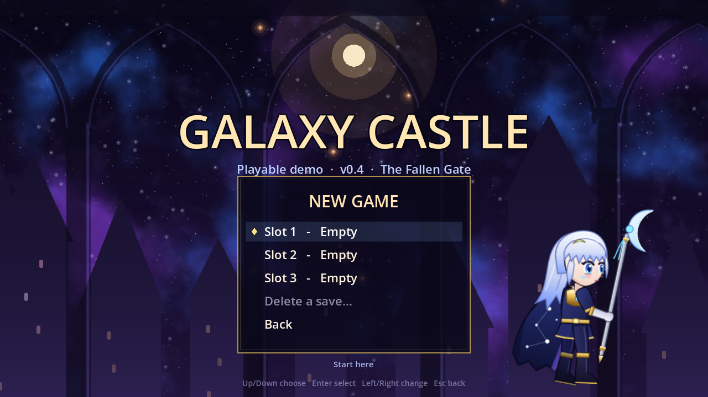
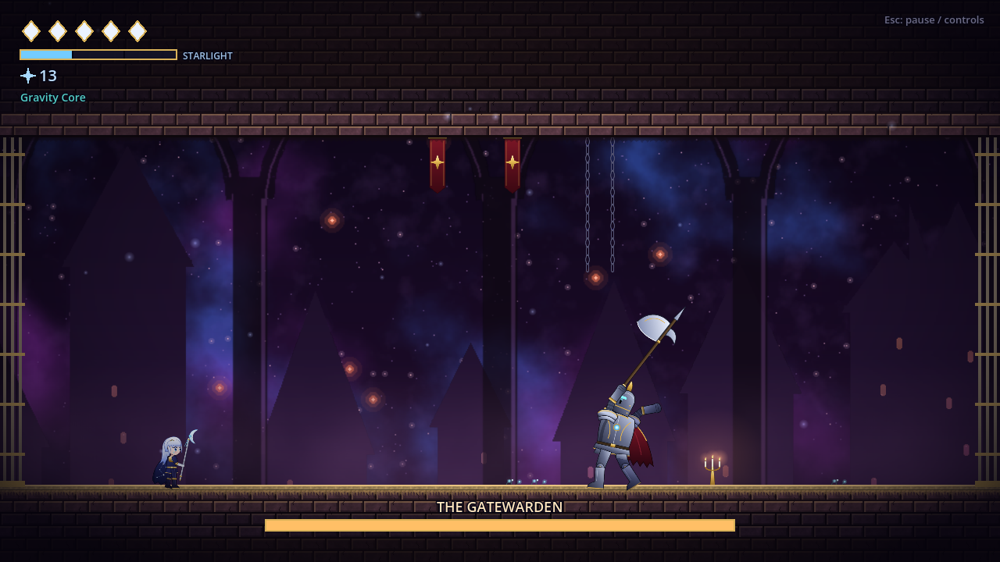
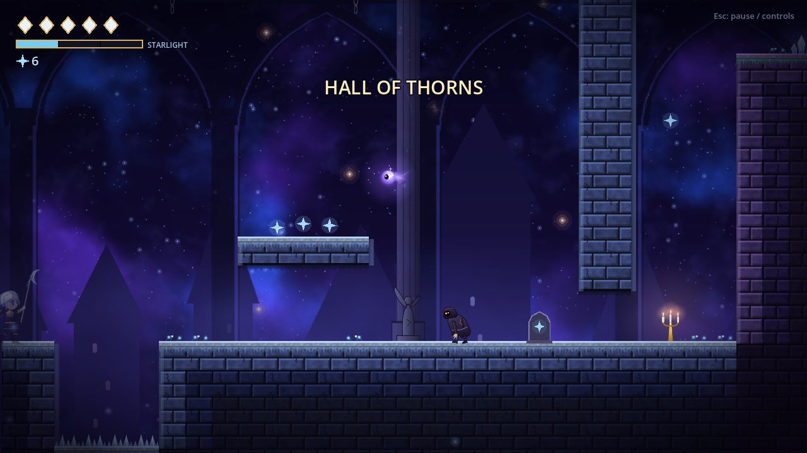

<div align="center">


# Galaxy Castle

**A 10–15 minute 2D action-platformer demo. Dash, parry, flip gravity to fight on the ceiling — and this build finally has a title screen, save slots and a camera that knows where to look.**

`v0.4 · The Fallen Gate` &nbsp;·&nbsp; Windows 10/11 (x64) &nbsp;·&nbsp; Made with Godot 4.7

[](#requirements)
[](#built-with)
[](CHANGELOG.md)
[](#roadmap)

[English](README.md) &nbsp;·&nbsp; [简体中文](README.zh-CN.md)

</div>

## Overview

**Galaxy Castle** is a side-scrolling action-platformer about Lune, a small guardian, and a castle that fell out of the sky. You run, wall-jump, dash through danger and parry with a glaive — and when the floor runs out, you **flip gravity** and keep fighting on the ceiling.

This repository hosts the **second public build, v0.4**: one short chapter called *The Fallen Gate*, now split into **five connected rooms** and framed with a proper front end — main menu, three save slots, a settings screen with key rebinding, and camera zones in the spirit of *Hollow Knight* and *Celeste*.

> **Just want to play?** Grab the zip from [Releases](../../releases), unpack it and double-click **`play.bat`**.

## Screenshots

| Title screen | Save slots |
| :---: | :---: |
|  |  |
| **The Gatewarden's hall** | **Corridor camera** |
|  |  |

More in [docs/screenshots](docs/screenshots/) — settings, key rebinding, the pause menu and the redrawn Lune.

## What's new in v0.4

- **Main menu** — Continue, New Game, Load Game, Settings, Quit (keyboard, gamepad or mouse).
- **Three save slots** — each shows its room, play time and Stardust. Saves happen at every Starwell, on death, after the boss and on *Save and quit*; slots can be deleted.
- **Settings** — master / music / effects volume, fullscreen, screen shake, and **key rebinding** (press a new key for any action; reset to defaults).
- **Pause menu** — Resume, Settings, Controls guide, Restart from last Starwell, Save and quit to title.
- **Camera zones** — corridors hold the camera height, the wall-jump shaft holds its column, open areas follow Lune (height only moves when she lands), and the Gatewarden's hall is a fixed, zoomed-out view of the whole arena.
- **Lune's face redrawn** in a correct three-quarter view (near eye by the ear, far eye past the nose bridge).

Saves live in `%APPDATA%\Godot\app_userdata\Galaxy Castle\saves\`.

## What's in the demo

- **Five rooms** — The Fallen Gate, Hall of Thorns, Broken Rampart, The Inverted Bridge, Gatewarden's Hall. Walking off the edge of a room fades into the next one, and each room introduces itself by name.
- **Movement** — run, jump (hold for height), wall-jump, and an invincible dash with afterimages.
- **Combat** — 3-hit glaive combo, up/down attacks, down-attack bounce, parry, and a held heal powered by Starlight.
- **Gravity Core** — the signature ability: flip gravity and walk on the ceiling across a spike pit.
- **Enemies** — the Husk (patrol + claw lunge) and the Wisp (flying charge). They return when you re-enter a room; collected Stardust stays collected.
- **Boss** — the Gatewarden: slam, charge and leap shockwaves; phase 2 adds Star Rain.
- **Systems** — Starwell checkpoints, Stardust, and Echo, who returns your Stardust after you die.

## Controls

| Action | Keyboard | Gamepad (Xbox layout) |
| --- | --- | --- |
| Move | `A` `D` / arrow keys | Left stick / D-pad |
| Aim attack up / down | `W` `S` / arrow keys | Left stick |
| Jump (hold = higher) | `Space` / `Z` | `A` |
| Attack (3-hit combo) | `J` / `X` | `X` |
| Dash (invincible) | `K` / `C` / `Shift` | `B` / `RT` |
| Parry | `L` / `V` | `RB` |
| Heal (hold) | `F` | `Y` |
| Flip gravity | `E` / `G` | `LB` / `LT` |
| Pause + control list | `Esc` / `P` | `Start` |
| Fullscreen | `F11` | — |

Every action can be rebound in **Settings → Controls**.

## Play it

### Requirements

- Windows 10 or 11, 64-bit
- ~250 MB of free disk space
- A keyboard, or a controller in Xbox layout

### Option A — Download (recommended)

1. Open [Releases](../../releases) and download `GalaxyCastle_Demo_v0.4_Windows.zip` (the v0.1 build is still there if you want to compare).
2. Extract the archive — don't run the game from inside the zip.
3. Double-click **`play.bat`**.

### Option B — Clone the repository

```bash
git clone https://github.com/hanghangworker-ui/Galaxy-Castle.git
cd Galaxy-Castle
```

Then double-click `play.bat` — or run `./play.bat` from a terminal.

### First launch

`play.bat` joins the four pieces in `data/` into `GalaxyCastle.exe` (about 105 MB — a few seconds), then starts the game. After that you can launch `GalaxyCastle.exe` directly.

> **“Windows protected your PC”** is expected: the demo is not code-signed yet. Click **More info → Run anyway**. Signing arrives with the Steam release.

> The assembled `GalaxyCastle.exe` is deliberately **not** committed (see the [FAQ](#faq)), so a fresh clone has no executable until the first launch. That's normal.

## Version history

| Build | What changed | Release |
| --- | --- | --- |
| **v0.4** | Main menu, 3 save slots, settings with key rebinding, pause menu, camera zones, new Lune face | `v0.4.0` |
| v0.3 | *The Fallen Gate* split into five connected rooms with fade transitions and room names | internal |
| v0.2 | Full art pass: animated characters, textured levels, parallax backgrounds, effects, better jump feel | internal |
| v0.1 | First playable demo — movement, combat, gravity, one boss | `v0.1.0` |

v0.1 and v0.4 are tagged and published as releases; v0.2 and v0.3 were internal steps on the way here. Full notes in [CHANGELOG.md](CHANGELOG.md).

## Repository layout

```
Galaxy-Castle/
├── play.bat                  # starts the game (assembles the exe on first run)
├── data/
│   ├── GalaxyCastle.exe.001  # the Godot export, split into 4 parts
│   ├── GalaxyCastle.exe.002
│   ├── GalaxyCastle.exe.003
│   └── GalaxyCastle.exe.004
├── docs/
│   ├── banner.png            # README header image
│   ├── social-preview.png    # GitHub → Settings → Social preview
│   ├── ART_GUIDE.md          # how to replace any character part with your own PNG
│   ├── PUBLISHING.md         # repo setup, releases, large files
│   └── screenshots/
├── tools/
│   ├── gen-banner.ps1        # regenerates banner.png and social-preview.png
│   ├── split-build.ps1       # splits a new Godot export into data/*.001–004
│   └── package-release.ps1   # builds the zip attached to a GitHub Release
├── CHANGELOG.md
├── README.md
└── README.zh-CN.md
```

## Art pipeline

Every character, enemy and decoration is built from named vector parts at runtime. To swap in your own drawing, drop a transparent PNG at `art/<folder>/<part>.png` — same name as the `.svg`, same box aspect ratio, pivot at the joint. [docs/ART_GUIDE.md](docs/ART_GUIDE.md) lists every part with its box size, pivot and a suggested pixel size, and the original `.svg` files work as tracing templates.

Tiles and backgrounds are already PNGs: overwrite them directly (tiles are 64 × 64 seamless, backgrounds tile horizontally).

## Built with

- [Godot Engine 4.7](https://godotengine.org/) — Windows x64 export
- Vector art generated in code; sound effects and two music loops are still placeholders

## Roadmap

- [x] v0.1 — first playable demo
- [x] v0.2 — art pass
- [x] v0.3 — five connected rooms
- [x] v0.4 — menus, saves, settings, camera zones
- [ ] Hand-drawn art replacing the vector parts (see the art guide)
- [ ] Real sound effects and music
- [ ] More rooms, a second boss
- [ ] Code-signed Steam build

## Known issues

- Windows only for now — no macOS or Linux build.
- The executable is unsigned, so Windows SmartScreen warns on first run.
- Sound effects and music are still placeholders; the art is vector work in progress.
- Settings and save slots are local to your machine — nothing syncs to the cloud.

## FAQ

<details>
<summary><strong>Why is the .exe split into four files?</strong></summary>

GitHub blocks files larger than 100 MB. The Godot export is about 105 MB, so it is stored as `data/GalaxyCastle.exe.001` … `.004` (≈27 MB each) and reassembled by `play.bat` on first launch. Each part stays below the limit, and the repository remains cloneable with a normal `git clone`.

</details>

<details>
<summary><strong>Why isn't the executable in the repository?</strong></summary>

`GalaxyCastle.exe` is a generated artifact: it is byte-identical to the concatenation of the four parts. Committing it would double the repository size for no benefit, so it is listed in `.gitignore`. For a single-file download, use the zip from [Releases](../../releases).

</details>

<details>
<summary><strong>Where are my saves?</strong></summary>

`%APPDATA%\Godot\app_userdata\Galaxy Castle\saves\` — three slots, one folder each. Deleting that folder resets your progress.

</details>

<details>
<summary><strong>Can I use Git LFS instead of split parts?</strong></summary>

Yes. Git LFS keeps large binaries out of the normal Git history, at the cost of an extra install step for anyone cloning. See [docs/PUBLISHING.md](docs/PUBLISHING.md#working-with-large-binaries) for the trade-offs and the commands.

</details>

## Feedback

Bug reports, balance notes and “this camera feels wrong” feedback are all welcome — please open an [issue](../../issues). Source code is not public yet, so pull requests are not accepted for now.

## License

This demo is **not** released under an open-source license yet. Unless a `LICENSE` file is added, all rights are reserved by the author — the game, its code, art and audio included.
