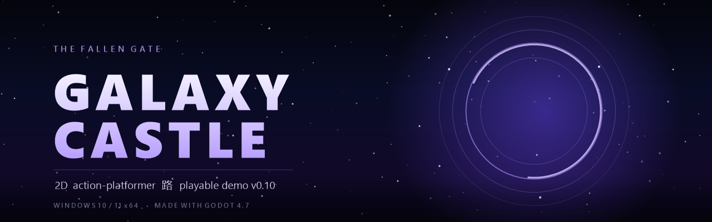
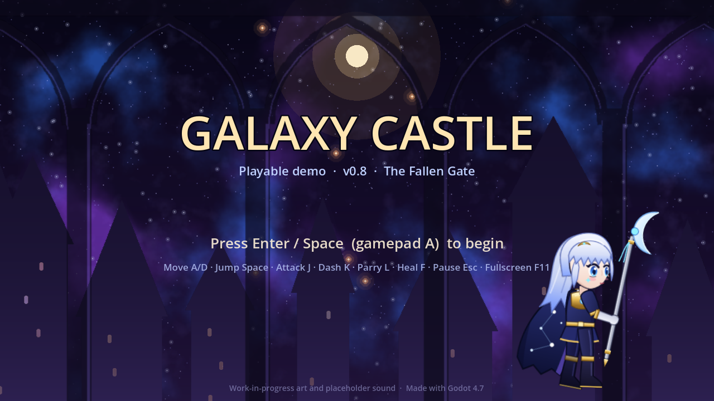
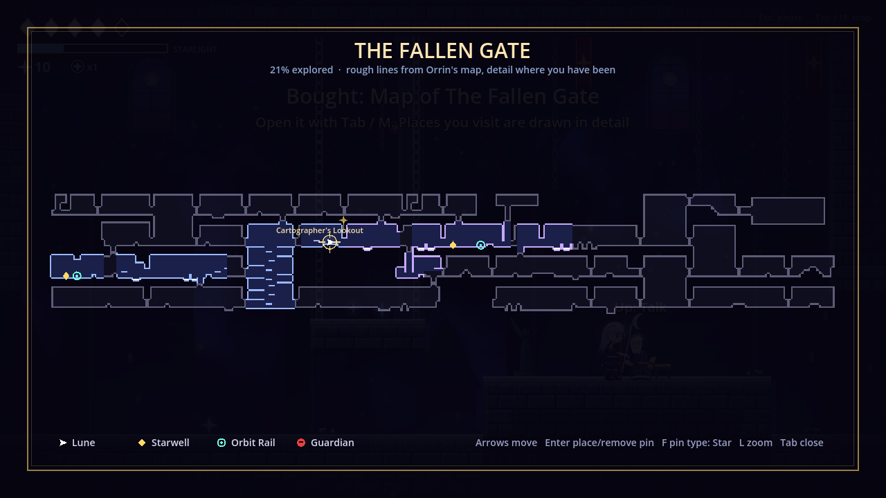
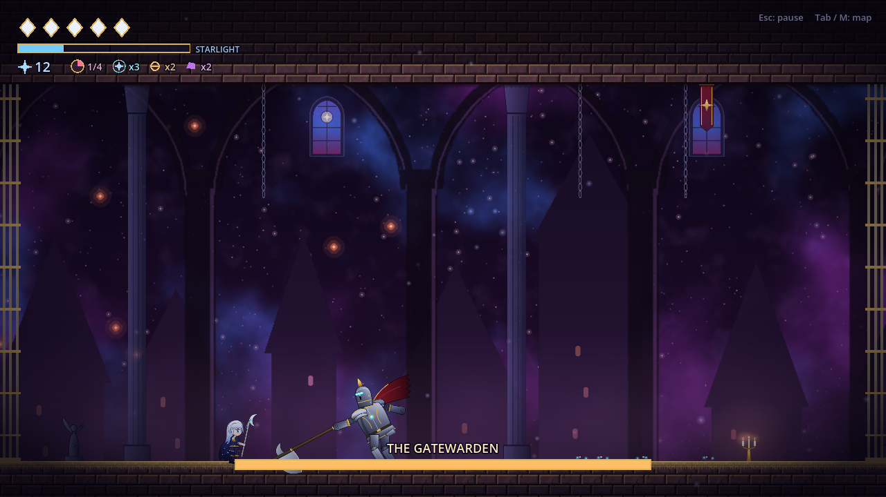
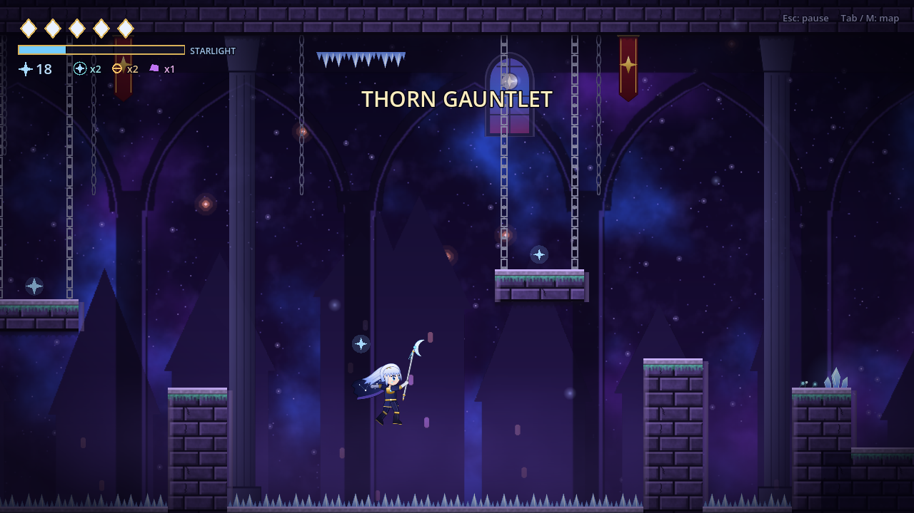

<div align="center">



# 银河城堡（Galaxy Castle）

**一款约 90 分钟的 2D 动作平台游戏 Demo。37 个房间、会骗过你的伪墙、轨道快传、Orin 画师的小小地图——这一版终于给每块悬浮石板都挂上了锁链。**

`v0.10 · The Fallen Gate` &nbsp;·&nbsp; Windows 10/11 (x64) &nbsp;·&nbsp; 使用 Godot 4.7 制作

[](#运行)
[](#制作)
[](CHANGELOG.md)
[](#路线图)

[简体中文](README.zh-CN.md) &nbsp;·&nbsp; [English](README.md)

</div>

## 简介

**《银河城堡》**是一款横版动作平台游戏：小守护者 Lune 守望着一座从天上掉下来的城堡。奔跑、跳跃、用戟弹反——当地面没了，就**翻转重力**，在天花板上继续打。

本仓库托管的是**第三个公开版本 v0.10**：*The Fallen Gate* 已扩展到 **37 个房间**，分为上层城防区与下层地穴区——伪墙和普通石头看起来一模一样（唯一的提示是声音：真石被戟敲会**响**，假石会**闷响**碎裂），制图师 Orrin 卖给你一张 Hollow Knight 风格的小地图，轨道快传让你在标记过的站点间瞬间移动。内容约 **1.5 小时**，全部集中在一个区域。

> **只想玩？** 去 [Releases](../../releases) 下载 zip，解压后双击 **`play.bat`**。

## 截图

| 标题画面 | Orrin 的地图（草图 + 细节） |
| :---: | :---: |
|  |  |
| **Gatewarden 大厅** | **荆棘试炼** |
|  |  |

[docs/screenshots](docs/screenshots/) 里还有 33 张游戏内截图——攀登井、重力翻转、敌人测试房、封印墓穴、Boss 各阶段。

## v0.10 更新了什么

- **结构逻辑重建。** 所有楼梯井（攀登井、 barbican、星落阶梯）现在是真正的阶梯通道：台阶嵌在墙里，短平台用锁链吊着。没有悬浮石板、没有开口下的台阶块、没有一格宽的缝隙——关卡生成器现在会拒绝所有这类结构。
- **骗你的伪墙。** 没有裂缝、没有闪光——唯一的提示是*声音*：真石头被戟敲会**响**，假石头**闷响**碎裂。墙后内容在破墙前画成实体岩石，破墙后渐显。隐藏房间在找到前不会出现在 Orrin 的地图上。
- **不同秘密、不同奖励**——Star Relic（黄铜星盘）、Comet Ore（+25 Stardust 宝箱）、石碑（按上键阅读）、Heart Fragment 与星座碎片。HUD 会统计 Relic 与 Ore 数量。
- **Day 8：驻防区（26–37 房）**——训练场（Drill Yard）、吊门机关（拉杆落下 Garrison Gate 的吊门，通往军械库的捷径）、回廊（Sally Port 折返星落阶梯）、带第四轨道站的新哨位。
- **两个来自数据文件的新敌人**——**Husk Brute**（大、慢、7 血、2 伤害）和 **Ember Wisp**（快、脆、前摇短）。
- **两个挑战房**（可选，Hollow Knight 试炼风格）：**荆棘试炼**（50 格尖刺，靠石柱与吊台通过）与**试炼竞技场**（三波敌人；宝藏室有 Comet Ore、Stardust 与石碑）。
- **规模：** 37 个房间，**24,753 个可玩 tile——v0.5 Fallen Gate 的 8.1 倍**（Day 9 目标 10 倍）。

v0.9、v0.8、v0.7、v0.6 是公开版本之间的内部迭代——完整历史（房间 5 → 12 → 25 → 37，地图、快传、数据驱动敌人、星井休息）见 [CHANGELOG.md](CHANGELOG.md)。

## Demo 内容（约 1.5 小时）

- **Lune**——奔跑、跳跃（长按更高）、3 连戟、上下劈、下劈弹跳、弹反、星光辉恢复。**Star Dash 是 Gatewarden 的掉落**；**蹬墙跳**与**重力翻转**在后续区域获得——Demo 按完整能力顺序演出。
- **37 个房间**，分三个翼区：捷径、拉杆吊门、伪墙与伪地板、3 个隐藏房、2 个挑战房，以及「以后再来」的视觉标记。
- **奖励**——Stardust、宝箱、Heart Fragment（4 个加 1 格血）、星座碎片、Star Relic、Comet Ore、石碑。
- **敌人**——Husk（巡逻 + 爪击）、Husk Brute、Wisp（飞行冲锋）、Ember Wisp、Spore Bloom（花瓣发光 → 孢子扇 → 毒云）、Vine Crawler（爬墙包平台，尖刺前转向）。全部由数据文件定义。
- **Boss**——Gatewarden：震地、冲锋、跳跃冲击波；二阶段 Star Rain。
- **系统**——可休息的 Starwell（回血、重生点、敌人刷新）、Orrin 地图与图钉、轨道快传（4 站）、3 个存档位、Echo（死亡后返还 Stardust）。
- **敌人测试房**——从主菜单进入，全能力解锁，不是真实关卡、不计存档；正式版会隐藏。

## 操作

| 动作 | 键盘 | 手柄（Xbox 布局） |
| --- | --- | --- |
| 移动 | `A` `D` / 方向键 | 左摇杆 / 十字键 |
| 上/下攻击 | `W` `S` / 方向键 | 左摇杆 |
| 跳跃（长按更高） | `Space` / `Z` | `A` |
| 攻击（3 连） | `J` / `X` | `X` |
| 冲刺（Gatewarden 后获得） | `K` / `C` / `Shift` | `B` / `RT` |
| 弹反 | `L` / `V` | `RB` |
| 恢复（按住） | `F` | `Y` |
| 翻转重力（后续区域） | `E` / `G` | `LB` / `LT` |
| 地图 + 快传 | `Tab` / `M` | Back / View |
| 暂停 + 按键表 | `Esc` / `P` | `Start` |
| 全屏 | `F11` | — |

所有按键都可以在 **设置 → 按键** 里重绑定。

## 运行

### 要求

- Windows 10 或 11，64 位
- 约 250 MB 磁盘空间
- 键盘，或 Xbox 布局手柄

### 方式 A——下载（推荐）

1. 打开 [Releases](../../releases)，下载 `GalaxyCastle_Demo_v0.10_Windows.zip`（旧版 v0.4、v0.1 也还在，可以对比）。
2. 解压 zip——不要直接在 zip 里运行。
3. 双击 **`play.bat`**。

### 方式 B——克隆仓库

```bash
git clone https://github.com/hanghangworker-ui/Galaxy-Castle.git
cd Galaxy-Castle
```

然后双击 `play.bat`——或从终端运行 `./play.bat`。

### 首次启动

`play.bat` 会把 `data/` 里的 **11 个分片**拼成 `GalaxyCastle.exe`（约 105 MB，几秒钟），然后启动游戏。之后也可以直接运行 `GalaxyCastle.exe`。

> **「Windows 已保护你的 PC」**是预期的：Demo 还没做代码签名。点 **更多信息 → 仍要运行**。签名版会随 Steam 发布出现。

> 拼好的 `GalaxyCastle.exe` 被**故意不提交**（见[常见问题](#常见问题)），所以新克隆的仓库在首次启动前没有可执行文件，这是正常的。

## 版本历史

| 版本 | 改动 | 发布 |
| --- | --- | --- |
| **v0.10** | 37 房、结构逻辑重建、伪墙、驻防区、2 个新敌人、2 个挑战房 | `v0.10.0` |
| v0.9 | 25 房、能力顺序按设计文档、"以后再来"标记 | 内部 |
| v0.8 | 数据驱动敌人、敌人测试房、Spore Bloom 与 Vine Crawler | 内部 |
| v0.7 | 星井休息、差异化奖励、敌人行为修正 | 内部 |
| v0.6 | 12 房、Orrin 的小地图 | 内部 |
| v0.5 | 地图 + 轨道快传、图钉 | 内部 |
| v0.4 | 主菜单、3 存档位、设置与按键重绑定、暂停菜单、镜头分区 | `v0.4.0` |
| v0.3 | *The Fallen Gate* 拆成 5 个相连房间 | 内部 |
| v0.2 | 全美术过场：动画角色、贴图关卡、视差背景 | 内部 |
| v0.1 | 首个可玩 Demo——移动、战斗、重力、1 个 Boss | `v0.1.0` |

v0.1、v0.4、v0.10 有标签并发布了 Release；其余是内部迭代。完整记录见 [CHANGELOG.md](CHANGELOG.md)。

## 仓库结构

```
Galaxy-Castle/
├── play.bat                  # 启动游戏（首次运行会拼装 exe）
├── data/
│   ├── GalaxyCastle.exe.001  # Godot 导出，切成 11 片（每片 ~10 MB）
│   ├── ...                   #        .002 – .010
│   └── GalaxyCastle.exe.011
├── docs/
│   ├── banner.png            # README 横幅
│   ├── social-preview.png    # GitHub → 设置 → 社交预览
│   ├── ART_GUIDE.md          # 如何用 PNG 替换任意角色部件
│   ├── PUBLISHING.md         # 建仓、发布、大文件
│   └── screenshots/          # 31 张游戏内截图
├── tools/
│   ├── gen-banner.ps1        # 重新生成 banner.png 与 social-preview.png
│   ├── split-build.ps1       # 把新的 Godot 导出切成 data/*.001–0NN
│   ├── package-release.ps1   # 打 Release 用的 zip
│   └── create-release.ps1    # 通过 API 直接发布 Release
├── CHANGELOG.md
├── README.md
└── README.zh-CN.md
```

## 美术管线

所有角色、敌人与装饰都在运行时由命名矢量部件拼成。要换成自己的画，把透明 PNG 放到 `art/<文件夹>/<部件>.png`——名字与 `.svg` 相同、比例相同、支点在关节处。[docs/ART_GUIDE.md](docs/ART_GUIDE.md) 列出每个部件的框尺寸、支点与建议像素大小；原始 `.svg` 文件可直接当描图模板用。

tile 与背景本来就是 PNG：直接覆盖（tile 是 64×64 无缝，背景横向平铺）。

## 制作

- [Godot Engine 4.7](https://godotengine.org/)——Windows x64 导出
- 矢量美术由代码生成；音效与两首音乐循环仍是占位

## 路线图

- [x] v0.1——首个可玩 Demo
- [x] v0.4——菜单、存档、设置、镜头分区
- [x] v0.10——37 房、伪墙、驻防区、挑战房
- [ ] Day 9——达到约 45 房、原始 Fallen Gate 的 10 倍 tile 数
- [ ] Nebula Gardens 区域（蹬墙跳 / 彗星爪奖励）
- [ ] Orrery Works 区域（重力翻转奖励）
- [ ] 第二个 Boss
- [ ] 手绘美术替换矢量部件（见美术指南）
- [ ] 真实音效与音乐
- [ ] 签名版 Steam 构建

## 已知问题

- 目前只有 Windows 版，没有 macOS / Linux。
- 可执行文件未签名，首次运行 Windows SmartScreen 会警告。
- 音效与音乐仍是占位；美术是矢量半成品。
- **敌人测试房**目前收在主菜单里，正式版会隐藏。
- 设置与存档只存本机，不会云同步。

## 常见问题

<details>
<summary><strong>为什么 exe 被切成 11 个文件？</strong></summary>

GitHub 限制单文件最大 100 MB。Godot 导出约 105 MB，所以存成 `data/GalaxyCastle.exe.001` … `.011`（每片约 10 MB），首次启动时由 `play.bat` 拼回。每片都远低于上限，仓库也能正常 `git clone`。

</details>

<details>
<summary><strong>为什么仓库里没有可执行文件？</strong></summary>

`GalaxyCastle.exe` 是生成物：它和 11 个分片拼接的结果逐字节一致。提交它会让仓库体积翻倍，没有好处，所以写进了 `.gitignore`。想下整包，用 [Releases](../../releases) 的 zip。

</details>

<details>
<summary><strong>存档在哪？</strong></summary>

`%APPDATA%\Godot\app_userdata\Galaxy Castle\saves\`——3 个槽位，每槽一个文件夹。删掉它即重置进度。

</details>

<details>
<summary><strong>旧存档还能用吗？</strong></summary>

v0.10 可以读取 v0.9 的存档（属性与能力保留），但要从 Fallen Gate 重新开始——房间位置变了。v0.9 读 v0.8 同理。

</details>

<details>
<summary><strong>可以用 Git LFS 代替分片吗？</strong></summary>

可以。Git LFS 把大二进制移出常规 Git 历史，代价是克隆的人要额外装 LFS。权衡与命令见 [docs/PUBLISHING.md](docs/PUBLISHING.md#large-files-lfs)。

</details>

## 反馈

Bug 报告、数值建议和「这里镜头不对」都欢迎——请提 [issue](../../issues)。源代码未公开，暂不接受 PR。

## 授权

本 Demo **未**采用开源许可证发布。在加入 `LICENSE` 文件之前，作者保留游戏、代码、美术与音频的全部权利。
